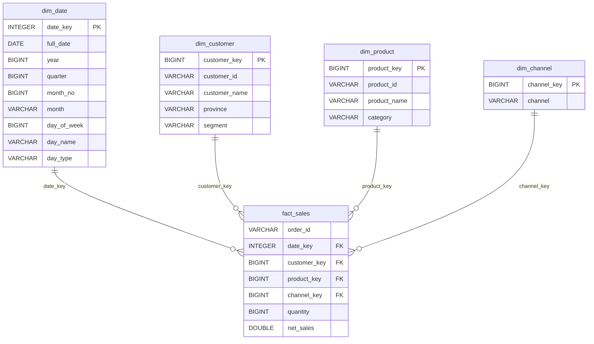

# Star Schema & OLAP Report

## Star Schema


## Validation: staging vs fact vs view (ต้องเท่ากัน)
```sql
SELECT 'stg_sales' AS src, COUNT(*) AS n_rows, ROUND(SUM(net_sales),2) AS total FROM stg_sales
UNION ALL SELECT 'fact_sales', COUNT(*), ROUND(SUM(net_sales),2) FROM fact_sales
UNION ALL SELECT 'v_sales', COUNT(*), ROUND(SUM(net_sales),2) FROM v_sales
```
| src | n_rows | total |
|---|---|---|
| stg_sales | 225 | 37580.25 |
| fact_sales | 225 | 37580.25 |
| v_sales | 225 | 37580.25 |


## Row count ของแต่ละตาราง
```sql
SELECT 'dim_date' AS tbl, COUNT(*) AS n FROM dim_date UNION ALL SELECT 'dim_customer' AS tbl, COUNT(*) AS n FROM dim_customer UNION ALL SELECT 'dim_product' AS tbl, COUNT(*) AS n FROM dim_product UNION ALL SELECT 'dim_channel' AS tbl, COUNT(*) AS n FROM dim_channel UNION ALL SELECT 'fact_sales' AS tbl, COUNT(*) AS n FROM fact_sales
```
| tbl | n |
|---|---|
| dim_date | 92 |
| dim_customer | 40 |
| dim_product | 8 |
| dim_channel | 3 |
| fact_sales | 225 |


## KPI ภาพรวม
```sql
SELECT COUNT(*) AS line_count, COUNT(DISTINCT order_id) AS order_count, ROUND(SUM(quantity),2) AS sum_quantity, ROUND(SUM(net_sales),2) AS sum_net_sales, ROUND(SUM(net_sales)/COUNT(DISTINCT order_id),2) AS aov, ROUND(AVG(net_sales),2) AS avg_line FROM v_sales
```
| line_count | order_count | sum_quantity | sum_net_sales | aov | avg_line |
|---|---|---|---|---|---|
| 225.0 | 225.0 | 542.0 | 37580.25 | 167.02 | 167.02 |


## Roll-up: รายเดือน
```sql
SELECT month, ROUND(SUM(net_sales),2) AS net_sales FROM v_sales GROUP BY month ORDER BY month
```
| month | net_sales |
|---|---|
| 2026-07 | 13763.95 |
| 2026-08 | 11479.65 |
| 2026-09 | 12336.65 |


## Drill-down: month × customer_name
```sql
SELECT month, customer_name, ROUND(SUM(net_sales),2) AS net_sales
FROM v_sales GROUP BY month, customer_name ORDER BY month, net_sales DESC
```
| month | customer_name | net_sales |
|---|---|---|
| 2026-07 | ลูกค้า 012 | 941.9 |
| 2026-07 | ลูกค้า 038 | 848.2 |
| 2026-07 | ลูกค้า 018 | 752.0 |
| 2026-07 | ลูกค้า 001 | 723.0 |
| 2026-07 | ลูกค้า 023 | 701.5 |
| 2026-07 | ลูกค้า 020 | 681.0 |
| 2026-07 | ลูกค้า 017 | 610.0 |
| 2026-07 | ลูกค้า 039 | 531.0 |
| 2026-07 | ลูกค้า 026 | 522.65 |
| 2026-07 | ลูกค้า 032 | 471.5 |
| 2026-07 | ลูกค้า 013 | 469.0 |
| 2026-07 | ลูกค้า 011 | 456.0 |
| 2026-07 | ลูกค้า 031 | 443.55 |
| 2026-07 | ลูกค้า 034 | 438.0 |
| 2026-07 | ลูกค้า 003 | 428.4 |
| 2026-07 | ลูกค้า 030 | 384.0 |
| 2026-07 | ลูกค้า 002 | 357.0 |
| 2026-07 | ลูกค้า 028 | 330.0 |
| 2026-07 | ลูกค้า 006 | 321.3 |
| 2026-07 | ลูกค้า 009 | 309.0 |
| 2026-07 | ลูกค้า 016 | 278.1 |
| 2026-07 | ลูกค้า 027 | 260.0 |
| 2026-07 | ลูกค้า 037 | 241.5 |
| 2026-07 | ลูกค้า 035 | 226.5 |
| 2026-07 | ลูกค้า 022 | 220.0 |
| 2026-07 | ลูกค้า 036 | 216.0 |
| 2026-07 | ลูกค้า 019 | 199.5 |
| 2026-07 | ลูกค้า 021 | 190.0 |
| 2026-07 | ลูกค้า 040 | 185.0 |
| 2026-07 | ลูกค้า 033 | 165.0 |
| 2026-07 | ลูกค้า 014 | 164.0 |
| 2026-07 | ลูกค้า 005 | 156.75 |
| 2026-07 | ลูกค้า 008 | 150.1 |
| 2026-07 | ลูกค้า 029 | 124.5 |
| 2026-07 | ลูกค้า 024 | 123.5 |
| 2026-07 | ลูกค้า 007 | 104.5 |
| 2026-07 | ลูกค้า 004 | 40.0 |
| 2026-08 | ลูกค้า 025 | 921.0 |
| 2026-08 | ลูกค้า 015 | 846.0 |
| 2026-08 | ลูกค้า 028 | 678.0 |
_…ดูครบใน CSV_


## Slice 2026-09: by customer_name
```sql
SELECT customer_name, ROUND(SUM(net_sales),2) AS net_sales
FROM v_sales WHERE month = '2026-09' GROUP BY customer_name ORDER BY net_sales DESC
```
| customer_name | net_sales |
|---|---|
| ลูกค้า 031 | 1039.5 |
| ลูกค้า 008 | 921.0 |
| ลูกค้า 040 | 720.9 |
| ลูกค้า 020 | 641.0 |
| ลูกค้า 003 | 610.2 |
| ลูกค้า 026 | 575.3 |
| ลูกค้า 007 | 570.0 |
| ลูกค้า 013 | 564.0 |
| ลูกค้า 036 | 541.3 |
| ลูกค้า 019 | 534.0 |
| ลูกค้า 015 | 497.0 |
| ลูกค้า 035 | 421.0 |
| ลูกค้า 034 | 419.0 |
| ลูกค้า 014 | 381.75 |
| ลูกค้า 006 | 379.0 |
| ลูกค้า 032 | 377.1 |
| ลูกค้า 017 | 368.0 |
| ลูกค้า 039 | 365.0 |
| ลูกค้า 033 | 323.25 |
| ลูกค้า 018 | 275.0 |
| ลูกค้า 022 | 235.0 |
| ลูกค้า 029 | 229.0 |
| ลูกค้า 021 | 224.05 |
| ลูกค้า 030 | 220.0 |
| ลูกค้า 037 | 210.0 |
| ลูกค้า 011 | 189.0 |
| ลูกค้า 009 | 165.3 |
| ลูกค้า 010 | 140.0 |
| ลูกค้า 024 | 70.0 |
| ลูกค้า 001 | 57.0 |
| ลูกค้า 027 | 54.0 |
| ลูกค้า 038 | 20.0 |


## Pivot: customer_name × month
```sql
SELECT * FROM (PIVOT (SELECT customer_name, month, net_sales FROM v_sales)
ON month USING SUM(net_sales) GROUP BY customer_name) ORDER BY customer_name
```
| customer_name | 2026-07 | 2026-08 | 2026-09 |
|---|---|---|---|
| ลูกค้า 001 | 723.0 | 119.0 | 57.0 |
| ลูกค้า 002 | 357.0 | 99.0 |  |
| ลูกค้า 003 | 428.4 | 187.0 | 610.2 |
| ลูกค้า 004 | 40.0 | 19.0 |  |
| ลูกค้า 005 | 156.75 | 321.0 |  |
| ลูกค้า 006 | 321.3 | 293.5 | 379.0 |
| ลูกค้า 007 | 104.5 | 67.5 | 570.0 |
| ลูกค้า 008 | 150.1 | 663.0 | 921.0 |
| ลูกค้า 009 | 309.0 | 454.0 | 165.3 |
| ลูกค้า 010 |  | 89.1 | 140.0 |
| ลูกค้า 011 | 456.0 | 549.15 | 189.0 |
| ลูกค้า 012 | 941.9 | 131.25 |  |
| ลูกค้า 013 | 469.0 | 386.29999999999995 | 564.0 |
| ลูกค้า 014 | 164.0 | 260.0 | 381.75 |
| ลูกค้า 015 |  | 846.0 | 497.0 |
| ลูกค้า 016 | 278.1 | 130.0 |  |
| ลูกค้า 017 | 610.0 | 337.0 | 368.0 |
| ลูกค้า 018 | 752.0 |  | 275.0 |
| ลูกค้า 019 | 199.5 |  | 534.0 |
| ลูกค้า 020 | 681.0 | 145.0 | 641.0 |
| ลูกค้า 021 | 190.0 |  | 224.05 |
| ลูกค้า 022 | 220.0 |  | 235.0 |
| ลูกค้า 023 | 701.5 | 510.4 |  |
| ลูกค้า 024 | 123.5 | 165.0 | 70.0 |
| ลูกค้า 025 |  | 921.0 |  |
| ลูกค้า 026 | 522.65 | 354.0 | 575.3 |
| ลูกค้า 027 | 260.0 | 423.0 | 54.0 |
| ลูกค้า 028 | 330.0 | 678.0 |  |
| ลูกค้า 029 | 124.5 | 413.0 | 229.0 |
| ลูกค้า 030 | 384.0 | 278.0 | 220.0 |
| ลูกค้า 031 | 443.55 |  | 1039.5 |
| ลูกค้า 032 | 471.5 | 439.5 | 377.1 |
| ลูกค้า 033 | 165.0 | 373.5 | 323.25 |
| ลูกค้า 034 | 438.0 | 447.0 | 419.0 |
| ลูกค้า 035 | 226.5 | 258.0 | 421.0 |
| ลูกค้า 036 | 216.0 | 201.25 | 541.3 |
| ลูกค้า 037 | 241.5 |  | 210.0 |
| ลูกค้า 038 | 848.2 | 60.0 | 20.0 |
| ลูกค้า 039 | 531.0 | 661.7 | 365.0 |
| ลูกค้า 040 | 185.0 | 199.5 | 720.9 |


## Drill-down: month × province
```sql
SELECT month, province, ROUND(SUM(net_sales),2) AS net_sales
FROM v_sales GROUP BY month, province ORDER BY month, net_sales DESC
```
| month | province | net_sales |
|---|---|---|
| 2026-07 | ฉะเชิงเทรา | 6966.35 |
| 2026-07 | ชลบุรี | 3009.3 |
| 2026-07 | ระยอง | 2724.1 |
| 2026-07 | กรุงเทพฯ | 1064.2 |
| 2026-08 | ฉะเชิงเทรา | 4980.95 |
| 2026-08 | ชลบุรี | 2753.0 |
| 2026-08 | ระยอง | 2563.45 |
| 2026-08 | กรุงเทพฯ | 1182.25 |
| 2026-09 | ฉะเชิงเทรา | 5932.0 |
| 2026-09 | ชลบุรี | 3756.3 |
| 2026-09 | ระยอง | 2087.05 |
| 2026-09 | กรุงเทพฯ | 561.3 |


## Slice 2026-09: by province
```sql
SELECT province, ROUND(SUM(net_sales),2) AS net_sales
FROM v_sales WHERE month = '2026-09' GROUP BY province ORDER BY net_sales DESC
```
| province | net_sales |
|---|---|
| ฉะเชิงเทรา | 5932.0 |
| ชลบุรี | 3756.3 |
| ระยอง | 2087.05 |
| กรุงเทพฯ | 561.3 |


## Pivot: province × month
```sql
SELECT * FROM (PIVOT (SELECT province, month, net_sales FROM v_sales)
ON month USING SUM(net_sales) GROUP BY province) ORDER BY province
```
| province | 2026-07 | 2026-08 | 2026-09 |
|---|---|---|---|
| กรุงเทพฯ | 1064.2 | 1182.25 | 561.3 |
| ฉะเชิงเทรา | 6966.35 | 4980.95 | 5932.0 |
| ชลบุรี | 3009.3 | 2753.0 | 3756.3 |
| ระยอง | 2724.1 | 2563.45 | 2087.05 |


## Drill-down: month × segment
```sql
SELECT month, segment, ROUND(SUM(net_sales),2) AS net_sales
FROM v_sales GROUP BY month, segment ORDER BY month, net_sales DESC
```
| month | segment | net_sales |
|---|---|---|
| 2026-07 | Walk-in | 9426.2 |
| 2026-07 | Member | 4337.75 |
| 2026-08 | Walk-in | 6129.6 |
| 2026-08 | Member | 5350.05 |
| 2026-09 | Walk-in | 9601.1 |
| 2026-09 | Member | 2735.55 |


## Slice 2026-09: by segment
```sql
SELECT segment, ROUND(SUM(net_sales),2) AS net_sales
FROM v_sales WHERE month = '2026-09' GROUP BY segment ORDER BY net_sales DESC
```
| segment | net_sales |
|---|---|
| Walk-in | 9601.1 |
| Member | 2735.55 |


## Pivot: segment × month
```sql
SELECT * FROM (PIVOT (SELECT segment, month, net_sales FROM v_sales)
ON month USING SUM(net_sales) GROUP BY segment) ORDER BY segment
```
| segment | 2026-07 | 2026-08 | 2026-09 |
|---|---|---|---|
| Member | 4337.75 | 5350.05 | 2735.55 |
| Walk-in | 9426.2 | 6129.599999999999 | 9601.099999999999 |


## Top 5 customer (customer_id)
```sql
SELECT customer_id, customer_name, province, segment, COUNT(*) AS n_lines, ROUND(SUM(net_sales),2) AS net_sales
FROM v_sales GROUP BY customer_id, customer_name, province, segment ORDER BY net_sales DESC LIMIT 5
```
| customer_id | customer_name | province | segment | n_lines | net_sales |
|---|---|---|---|---|---|
| C008 | ลูกค้า 008 | ชลบุรี | Walk-in | 9 | 1734.1 |
| C039 | ลูกค้า 039 | ฉะเชิงเทรา | Walk-in | 9 | 1557.7 |
| C031 | ลูกค้า 031 | ฉะเชิงเทรา | Walk-in | 8 | 1483.05 |
| C020 | ลูกค้า 020 | ฉะเชิงเทรา | Member | 7 | 1467.0 |
| C026 | ลูกค้า 026 | ชลบุรี | Walk-in | 12 | 1451.95 |


## Drill-down: month × product_name
```sql
SELECT month, product_name, ROUND(SUM(net_sales),2) AS net_sales
FROM v_sales GROUP BY month, product_name ORDER BY month, net_sales DESC
```
| month | product_name | net_sales |
|---|---|---|
| 2026-07 | เค้กช็อกโกแลต | 2836.35 |
| 2026-07 | กาแฟเย็น | 2265.25 |
| 2026-07 | สลัดไก่ | 2249.1 |
| 2026-07 | แซนด์วิช | 2091.5 |
| 2026-07 | ชาไทย | 1861.75 |
| 2026-07 | โกโก้ | 1333.5 |
| 2026-07 | ครัวซองต์ | 697.5 |
| 2026-07 | น้ำเปล่า | 429.0 |
| 2026-08 | เค้กช็อกโกแลต | 2351.25 |
| 2026-08 | โกโก้ | 1858.5 |
| 2026-08 | ครัวซองต์ | 1785.0 |
| 2026-08 | สลัดไก่ | 1755.25 |
| 2026-08 | ชาไทย | 1509.75 |
| 2026-08 | แซนด์วิช | 854.4 |
| 2026-08 | กาแฟเย็น | 838.5 |
| 2026-08 | น้ำเปล่า | 527.0 |
| 2026-09 | โกโก้ | 2492.0 |
| 2026-09 | สลัดไก่ | 2225.3 |
| 2026-09 | กาแฟเย็น | 1719.25 |
| 2026-09 | เค้กช็อกโกแลต | 1707.75 |
| 2026-09 | ชาไทย | 1551.0 |
| 2026-09 | ครัวซองต์ | 1451.25 |
| 2026-09 | แซนด์วิช | 881.1 |
| 2026-09 | น้ำเปล่า | 309.0 |


## Slice 2026-09: by product_name
```sql
SELECT product_name, ROUND(SUM(net_sales),2) AS net_sales
FROM v_sales WHERE month = '2026-09' GROUP BY product_name ORDER BY net_sales DESC
```
| product_name | net_sales |
|---|---|
| โกโก้ | 2492.0 |
| สลัดไก่ | 2225.3 |
| กาแฟเย็น | 1719.25 |
| เค้กช็อกโกแลต | 1707.75 |
| ชาไทย | 1551.0 |
| ครัวซองต์ | 1451.25 |
| แซนด์วิช | 881.1 |
| น้ำเปล่า | 309.0 |


## Pivot: product_name × month
```sql
SELECT * FROM (PIVOT (SELECT product_name, month, net_sales FROM v_sales)
ON month USING SUM(net_sales) GROUP BY product_name) ORDER BY product_name
```
| product_name | 2026-07 | 2026-08 | 2026-09 |
|---|---|---|---|
| กาแฟเย็น | 2265.25 | 838.5 | 1719.25 |
| ครัวซองต์ | 697.5 | 1785.0 | 1451.25 |
| ชาไทย | 1861.75 | 1509.75 | 1551.0 |
| น้ำเปล่า | 429.0 | 527.0 | 309.0 |
| สลัดไก่ | 2249.1000000000004 | 1755.25 | 2225.3 |
| เค้กช็อกโกแลต | 2836.35 | 2351.25 | 1707.75 |
| แซนด์วิช | 2091.5 | 854.4 | 881.1 |
| โกโก้ | 1333.5 | 1858.5 | 2492.0 |


## Drill-down: month × category
```sql
SELECT month, category, ROUND(SUM(net_sales),2) AS net_sales
FROM v_sales GROUP BY month, category ORDER BY month, net_sales DESC
```
| month | category | net_sales |
|---|---|---|
| 2026-07 | เครื่องดื่ม | 5889.5 |
| 2026-07 | อาหาร | 4340.6 |
| 2026-07 | เบเกอรี | 3533.85 |
| 2026-08 | เครื่องดื่ม | 4733.75 |
| 2026-08 | เบเกอรี | 4136.25 |
| 2026-08 | อาหาร | 2609.65 |
| 2026-09 | เครื่องดื่ม | 6071.25 |
| 2026-09 | เบเกอรี | 3159.0 |
| 2026-09 | อาหาร | 3106.4 |


## Slice 2026-09: by category
```sql
SELECT category, ROUND(SUM(net_sales),2) AS net_sales
FROM v_sales WHERE month = '2026-09' GROUP BY category ORDER BY net_sales DESC
```
| category | net_sales |
|---|---|
| เครื่องดื่ม | 6071.25 |
| เบเกอรี | 3159.0 |
| อาหาร | 3106.4 |


## Pivot: category × month
```sql
SELECT * FROM (PIVOT (SELECT category, month, net_sales FROM v_sales)
ON month USING SUM(net_sales) GROUP BY category) ORDER BY category
```
| category | 2026-07 | 2026-08 | 2026-09 |
|---|---|---|---|
| อาหาร | 4340.6 | 2609.65 | 3106.4 |
| เครื่องดื่ม | 5889.5 | 4733.75 | 6071.25 |
| เบเกอรี | 3533.85 | 4136.25 | 3159.0 |


## Top 5 product (product_id)
```sql
SELECT product_id, product_name, category, COUNT(*) AS n_lines, ROUND(SUM(net_sales),2) AS net_sales
FROM v_sales GROUP BY product_id, product_name, category ORDER BY net_sales DESC LIMIT 5
```
| product_id | product_name | category | n_lines | net_sales |
|---|---|---|---|---|
| P06 | เค้กช็อกโกแลต | เบเกอรี | 27 | 6895.35 |
| P07 | สลัดไก่ | อาหาร | 24 | 6229.65 |
| P05 | โกโก้ | เครื่องดื่ม | 32 | 5684.0 |
| P02 | ชาไทย | เครื่องดื่ม | 35 | 4922.5 |
| P01 | กาแฟเย็น | เครื่องดื่ม | 32 | 4823.0 |


## Drill-down: month × channel
```sql
SELECT month, channel, ROUND(SUM(net_sales),2) AS net_sales
FROM v_sales GROUP BY month, channel ORDER BY month, net_sales DESC
```
| month | channel | net_sales |
|---|---|---|
| 2026-07 | เดลิเวอรี | 5872.15 |
| 2026-07 | ออนไลน์ | 4324.65 |
| 2026-07 | หน้าร้าน | 3567.15 |
| 2026-08 | เดลิเวอรี | 4455.6 |
| 2026-08 | หน้าร้าน | 3586.35 |
| 2026-08 | ออนไลน์ | 3437.7 |
| 2026-09 | หน้าร้าน | 5232.15 |
| 2026-09 | ออนไลน์ | 4279.95 |
| 2026-09 | เดลิเวอรี | 2824.55 |


## Slice 2026-09: by channel
```sql
SELECT channel, ROUND(SUM(net_sales),2) AS net_sales
FROM v_sales WHERE month = '2026-09' GROUP BY channel ORDER BY net_sales DESC
```
| channel | net_sales |
|---|---|
| หน้าร้าน | 5232.15 |
| ออนไลน์ | 4279.95 |
| เดลิเวอรี | 2824.55 |


## Pivot: channel × month
```sql
SELECT * FROM (PIVOT (SELECT channel, month, net_sales FROM v_sales)
ON month USING SUM(net_sales) GROUP BY channel) ORDER BY channel
```
| channel | 2026-07 | 2026-08 | 2026-09 |
|---|---|---|---|
| หน้าร้าน | 3567.15 | 3586.35 | 5232.15 |
| ออนไลน์ | 4324.65 | 3437.7 | 4279.950000000001 |
| เดลิเวอรี | 5872.150000000001 | 4455.6 | 2824.55 |


## Top 5 channel (channel)
```sql
SELECT channel, COUNT(*) AS n_lines, ROUND(SUM(net_sales),2) AS net_sales
FROM v_sales GROUP BY channel ORDER BY net_sales DESC LIMIT 5
```
| channel | n_lines | net_sales |
|---|---|---|
| เดลิเวอรี | 80 | 13152.3 |
| หน้าร้าน | 78 | 12385.65 |
| ออนไลน์ | 67 | 12042.3 |


## ROLLUP (segment, category) subtotal + grand total
```sql
SELECT segment, category, ROUND(SUM(net_sales),2) AS net_sales,
GROUPING(segment, category) AS lvl FROM v_sales GROUP BY ROLLUP (segment, category)
ORDER BY segment NULLS LAST, lvl, net_sales DESC
```
| segment | category | net_sales | lvl |
|---|---|---|---|
| Member | เครื่องดื่ม | 5554.5 | 0 |
| Member | อาหาร | 3949.85 | 0 |
| Member | เบเกอรี | 2919.0 | 0 |
| Member |  | 12423.35 | 1 |
| Walk-in | เครื่องดื่ม | 11140.0 | 0 |
| Walk-in | เบเกอรี | 7910.1 | 0 |
| Walk-in | อาหาร | 6106.8 | 0 |
| Walk-in |  | 25156.9 | 1 |
|  |  | 37580.25 | 3 |


## CUBE (segment, category)
```sql
SELECT segment, category, ROUND(SUM(net_sales),2) AS net_sales FROM v_sales
GROUP BY CUBE (segment, category) ORDER BY segment NULLS LAST, category NULLS LAST
```
| segment | category | net_sales |
|---|---|---|
| Member | อาหาร | 3949.85 |
| Member | เครื่องดื่ม | 5554.5 |
| Member | เบเกอรี | 2919.0 |
| Member |  | 12423.35 |
| Walk-in | อาหาร | 6106.8 |
| Walk-in | เครื่องดื่ม | 11140.0 |
| Walk-in | เบเกอรี | 7910.1 |
| Walk-in |  | 25156.9 |
|  | อาหาร | 10056.65 |
|  | เครื่องดื่ม | 16694.5 |
|  | เบเกอรี | 10829.1 |
|  |  | 37580.25 |


## Rank category ภายในแต่ละ segment
```sql
SELECT segment, category, ROUND(SUM(net_sales),2) AS net_sales,
RANK() OVER (PARTITION BY segment ORDER BY SUM(net_sales) DESC) AS rnk FROM v_sales
GROUP BY segment, category ORDER BY segment, rnk
```
| segment | category | net_sales | rnk |
|---|---|---|---|
| Member | เครื่องดื่ม | 5554.5 | 1 |
| Member | อาหาร | 3949.85 | 2 |
| Member | เบเกอรี | 2919.0 | 3 |
| Walk-in | เครื่องดื่ม | 11140.0 | 1 |
| Walk-in | เบเกอรี | 7910.1 | 2 |
| Walk-in | อาหาร | 6106.8 | 3 |


## ยอดรายวัน + MA7
```sql
WITH d AS (SELECT full_date, SUM(net_sales) s FROM v_sales GROUP BY 1)
SELECT full_date, ROUND(s,2) AS daily, ROUND(AVG(s) OVER (ORDER BY full_date ROWS BETWEEN 6 PRECEDING AND CURRENT ROW),2) AS ma7,
ROUND(SUM(s) OVER (ORDER BY full_date),2) AS running_total FROM d ORDER BY 1
```
| full_date | daily | ma7 | running_total |
|---|---|---|---|
| 2026-07-01 00:00:00 | 245.75 | 245.75 | 245.75 |
| 2026-07-02 00:00:00 | 197.5 | 221.63 | 443.25 |
| 2026-07-03 00:00:00 | 49.5 | 164.25 | 492.75 |
| 2026-07-04 00:00:00 | 316.25 | 202.25 | 809.0 |
| 2026-07-05 00:00:00 | 140.0 | 189.8 | 949.0 |
| 2026-07-06 00:00:00 | 220.0 | 194.83 | 1169.0 |
| 2026-07-07 00:00:00 | 648.4 | 259.63 | 1817.4 |
| 2026-07-08 00:00:00 | 476.0 | 292.52 | 2293.4 |
| 2026-07-09 00:00:00 | 300.5 | 307.24 | 2593.9 |
| 2026-07-10 00:00:00 | 983.3 | 440.64 | 3577.2 |
| 2026-07-11 00:00:00 | 279.1 | 435.33 | 3856.3 |
| 2026-07-12 00:00:00 | 324.0 | 461.61 | 4180.3 |
| 2026-07-13 00:00:00 | 472.0 | 497.61 | 4652.3 |
| 2026-07-15 00:00:00 | 186.75 | 431.66 | 4839.05 |
| 2026-07-16 00:00:00 | 478.5 | 432.02 | 5317.55 |
| 2026-07-17 00:00:00 | 1274.7 | 571.19 | 6592.25 |
| 2026-07-18 00:00:00 | 255.25 | 467.19 | 6847.5 |
| 2026-07-19 00:00:00 | 769.0 | 537.17 | 7616.5 |
| 2026-07-20 00:00:00 | 890.0 | 618.03 | 8506.5 |
| 2026-07-21 00:00:00 | 199.5 | 579.1 | 8706.0 |
| 2026-07-22 00:00:00 | 547.5 | 630.64 | 9253.5 |
| 2026-07-23 00:00:00 | 75.0 | 572.99 | 9328.5 |
| 2026-07-24 00:00:00 | 405.3 | 448.79 | 9733.8 |
| 2026-07-25 00:00:00 | 333.0 | 459.9 | 10066.8 |
| 2026-07-26 00:00:00 | 1296.65 | 535.28 | 11363.45 |
| 2026-07-27 00:00:00 | 60.0 | 416.71 | 11423.45 |
| 2026-07-28 00:00:00 | 1081.5 | 542.71 | 12504.95 |
| 2026-07-29 00:00:00 | 1259.0 | 644.35 | 13763.95 |
| 2026-08-01 00:00:00 | 344.0 | 682.78 | 14107.95 |
| 2026-08-02 00:00:00 | 317.0 | 670.16 | 14424.95 |
| 2026-08-03 00:00:00 | 741.5 | 728.52 | 15166.45 |
| 2026-08-04 00:00:00 | 129.1 | 561.73 | 15295.55 |
| 2026-08-05 00:00:00 | 123.5 | 570.8 | 15419.05 |
| 2026-08-06 00:00:00 | 368.0 | 468.87 | 15787.05 |
| 2026-08-07 00:00:00 | 282.15 | 329.32 | 16069.2 |
| 2026-08-08 00:00:00 | 580.0 | 363.04 | 16649.2 |
| 2026-08-09 00:00:00 | 324.0 | 364.04 | 16973.2 |
| 2026-08-10 00:00:00 | 63.0 | 267.11 | 17036.2 |
| 2026-08-11 00:00:00 | 690.0 | 347.24 | 17726.2 |
| 2026-08-12 00:00:00 | 339.25 | 378.06 | 18065.45 |
_…ดูครบใน CSV_

